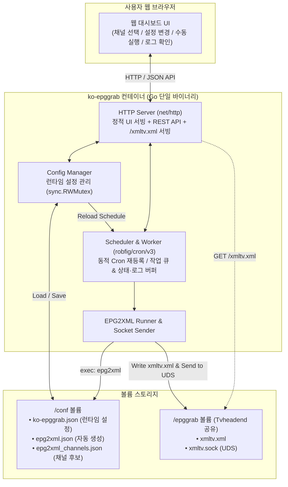

# ko-epggrab 런타임 웹 설정 UI 기획서

## 1. 배경 및 목표

### 1.1 현재 구조의 한계점
현재 `ko-epggrab`은 CLI 플래그(`-fc`, `-lc`, `-pc`, `-nf`, `-ss`, `-d`)와 환경 변수를 조합하여 실행 시점에 설정을 주입하는 방식으로 동작합니다. 이 방식은 다음과 같은 불편함과 구조적 한계를 가지고 있습니다.

1. **채널 탐색과 설정의 번거로움**: 어떤 EPG 프로바이더에 어떤 카테고리와 채널명이 있는지 확인하려면 먼저 컨테이너를 `-fc -lc` 옵션으로 일회성 실행해 YAML 출력을 확인한 뒤, `docker-compose.yml`의 `command`에 `-pc "NAVER:지상파,종합 편성;LG:홈쇼핑"`과 `-nf "경인 KBS1,KBS2,..."` 같은 복잡한 문자열을 수동으로 작성해야 합니다.
2. **런타임 설정 변경 불가**: 채널 하나를 추가/제외하거나 옵션을 바꾸려면 `docker-compose.yml`을 수정하고 컨테이너를 재시작해야 합니다.
3. **필터링 표현력의 한계**:
   - `-nf`(채널명 허용 필터)가 전역으로 동작하여 프로바이더별로 정교하게 채널을 고르기 어렵습니다.
   - `WAVVE`, `SPOTV` 등 일부 프로바이더의 채널은 `Category` 필드가 비어 있어 기존 `프로바이더:카테고리`(`-pc`) 문법으로 선택하기 모호합니다.
   - 현재 [`Channel`](file:///Users/suapapa/ws_suapapa/ko-epggrab/epg2xml.go#L37-L43) 구조체에 `Icon_url`, `Id` 등의 필드가 빠져 있어 `epg2xml.json` 생성 시 채널 아이콘 URL 등 부가 정보가 유실됩니다.
4. **데몬 모드에서의 채널 갱신 미반영**: [`main.go`](file:///Users/suapapa/ws_suapapa/ko-epggrab/main.go#L120-L153)에서 프로세스 시작 시 계산된 `selectedChannels` 슬라이스를 클로저로 계속 재사용하므로, 매주 채널 목록 갱신(`CRON_CHANNEL_FETCH`)이 실행되어도 새로 추가되거나 변경된 채널 정보가 XMLTV 생성에 반영되지 않습니다.
5. **상태 모니터링 및 수동 제어 부재**: 마지막 EPG 생성 시각, 성공/실패 여부, 에러 로그를 확인하거나 즉시 갱신을 트리거할 방법이 없습니다.

### 1.2 개편 목표
- **CLI 플래그 전면 폐기**: 기존의 모든 실행 플래그(`-fc`, `-lc`, `-pc`, `-nf`, `-ss`, `-d`)를 제거하고, 실행 시 **데몬 + 내장 웹 서버** 모드로 동작을 일원화합니다.
- **웹 UI를 통한 런타임 설정 변경**: 브라우저에서 전체 채널 목록을 검색·필터링하여 직관적으로 선택하고, Cron 주기·소켓 전송 여부·`epg2xml` 세부 옵션을 컨테이너 재시작 없이 즉시 변경 및 반영합니다.
- **수동 실행 및 모니터링 제공**: 웹 대시보드에서 **[채널 목록 지금 갱신]**, **[XMLTV 지금 생성 및 전송]**을 즉시 실행하고, 진행 상태와 최근 실행 로그를 실시간으로 확인합니다.
- **단일 바이너리 배포 유지**: Go 표준 라이브러리의 `embed` 패키지(`//go:embed`)로 웹 프론트엔드 자산을 바이너리에 내장하여, 기존과 동일한 경량 Docker 이미지 구성을 유지합니다.

---

## 2. 시스템 아키텍처



### 핵심 동작 흐름
1. **부팅 시점 (`Startup`)**
   - 환경 변수로부터 파일 경로 및 웹 서버 바인딩 주소(`HTTP_ADDR`, 기본 `:8080`)를 로드합니다.
   - `/conf/ko-epggrab.json`이 존재하면 로드하고, 없으면 기본값(및 기존 환경 변수 `CRON_*`, 기존 `epg2xml.json`의 `GLOBAL`/`MY_CHANNELS`)을 기반으로 초기 설정 파일을 생성합니다.
   - `/conf/epg2xml_channels.json`이 없거나 비어 있으면 백그라운드 작업으로 초기 채널 목록 갱신(`epg2xml update_channels`)을 자동 트리거합니다.
   - Cron 스케줄러와 HTTP 웹 서버를 시작합니다.
2. **설정 변경 시점 (`Runtime Update`)**
   - 사용자가 웹 UI에서 채널 선택 또는 스케줄/옵션을 수정하고 저장하면 `PUT /api/config`가 호출됩니다.
   - `Config Manager`가 메모리의 설정을 갱신하고 `/conf/ko-epggrab.json` 및 `/conf/epg2xml.json`에 원자적(atomic)으로 저장합니다.
   - Cron 표현식이 변경된 경우, `Scheduler`의 기존 Cron 엔트리를 제거하고 새 표현식으로 즉시 재등록합니다.
3. **작업 실행 시점 (`Cron` 또는 `수동 트리거`)**
   - 작업 중 중복 실행을 막기 위해 워커 뮤텍스로 단일 실행을 보장하고, 현재 상태(`idle`, `fetching_channels`, `generating_xmltv`)를 갱신합니다.
   - XMLTV 생성 시 최신 `epg2xml_channels.json`과 현재 설정(`ko-epggrab.json`)을 결합해 `epg2xml.json`을 생성한 뒤 `epg2xml run`을 실행하고, 설정에 따라 `xmltv.sock`으로 전송합니다.
   - 실행 과정의 표준 출력/에러를 메모리 내 링 버퍼(Ring Buffer)에 기록하여 웹 UI에서 조회할 수 있게 합니다.

---

## 3. 설정 체계 설계

### 3.1 CLI 플래그 폐기
기존 [`main.go`](file:///Users/suapapa/ws_suapapa/ko-epggrab/main.go#L38-L44)의 모든 CLI 플래그를 폐기합니다.

| 폐기 플래그 | 기존 역할 | 대체 방식 |
| :--- | :--- | :--- |
| `-fc` | 시작 시 채널 목록 갱신 | 웹 UI의 **[채널 목록 지금 갱신]** 버튼 + 최초 기동 시 채널 파일이 없으면 자동 갱신 |
| `-lc` | 채널 목록 YAML 출력 후 종료 | 웹 UI의 **채널 선택 탭** (프로바이더/카테고리/검색 필터 지원) |
| `-pc` | 프로바이더 및 카테고리 선택 | 웹 UI에서 프로바이더/카테고리별 탐색 및 체크박스 선택 |
| `-nf` | 채널 이름 화이트리스트 필터 | 웹 UI에서 개별 채널 체크박스 선택 및 실시간 검색 |
| `-ss` | Unix Domain Socket 전송 여부 | 웹 UI 설정의 **Tvheadend 소켓(`xmltv.sock`) 자동 전송** 토글 (`send_to_socket`) |
| `-d` | 데몬 모드 실행 | 기본 동작으로 고정 (항상 데몬 + 웹 서버로 실행) |

### 3.2 인프라 환경 변수 (부트스트랩 전용)
컨테이너 내부 경로와 포트 바인딩만 환경 변수로 제어하며, 스케줄 환경 변수(`CRON_*`)는 최초 설정 파일 생성 시의 초기값(Seed)으로만 사용합니다.

| 환경 변수 | 기본값 (로컬) | 기본값 (Docker) | 설명 |
| :--- | :--- | :--- | :--- |
| `HTTP_ADDR` | `:8080` | `:8080` | 웹 UI 및 API 서버 리스닝 주소 |
| `KO_EPGGRAB_CONF` | `./epg2xml_conf/ko-epggrab.json` | `/conf/ko-epggrab.json` | `ko-epggrab` 런타임 설정 저장 경로 |
| `EPG2XML_CHANNEL_CONF` | `./epg2xml_conf/epg2xml_channels.json` | `/conf/epg2xml_channels.json` | `epg2xml` 전체 채널 목록 파일 경로 |
| `EPG2XML_PROGRAM_CONF` | `./epg2xml_conf/epg2xml.json` | `/conf/epg2xml.json` | `epg2xml` 실행용 설정 파일 경로 |
| `XMLTV_XML_PATH` | `./epggrab/xmltv.xml` | `/epggrab/xmltv.xml` | 생성될 XMLTV 파일 경로 |
| `XMLTV_SOCK_PATH` | `./epggrab/xmltv.sock` | `/epggrab/xmltv.sock` | Tvheadend XMLTV Unix Domain Socket 경로 |

### 3.3 런타임 설정 파일 스키마 (`ko-epggrab.json`)
`epg2xml`은 실행 시 자신의 설정 파일(`epg2xml.json`)을 읽고 자체 포맷으로 다시 쓰는 특성이 있습니다. 따라서 `ko-epggrab` 고유의 설정이 유실되지 않도록 `ko-epggrab.json`을 **Single Source of Truth**로 관리하고, `epg2xml` 실행 직전에 `epg2xml.json`을 생성합니다.

```json
{
  "cron_channel_fetch": "0 0 * * 1",
  "cron_generate_xmltv": "0 */12 * * *",
  "send_to_socket": true,
  "epg2xml_global": {
    "ENABLED": true,
    "FETCH_LIMIT": 2,
    "ID_FORMAT": "{ServiceId}.{Source.lower()}",
    "ADD_REBROADCAST_TO_TITLE": false,
    "ADD_EPNUM_TO_TITLE": true,
    "ADD_DESCRIPTION": true,
    "ADD_XMLTV_NS": false,
    "GET_MORE_DETAILS": false,
    "ADD_CHANNEL_ICON": true,
    "HTTP_PROXY": null
  },
  "selected_channels": {
    "NAVER": [
      {
        "Name": "KBS1",
        "ServiceId": "814574",
        "Category": "지상파"
      },
      {
        "Name": "KBS2",
        "ServiceId": "814575",
        "Category": "지상파"
      }
    ],
    "KT": [
      {
        "Name": "ENA",
        "No": "1",
        "ServiceId": "1",
        "Category": "드라마/버라이어티"
      }
    ]
  }
}
```

> [!IMPORTANT]
> **채널 목록 갱신 시 최신 메타데이터 동기화**
> 매주 `epg2xml_channels.json`이 업데이트될 때, `selected_channels`에 저장된 각 채널의 `Provider` + `ServiceId`를 기준으로 최신 채널 정보(`Name`, `No`, `Category`, `Icon_url` 등)를 매칭하여 `epg2xml.json`의 `MY_CHANNELS`에 반영합니다.

---

## 4. 웹 UI 화면 기획

> [!NOTE]
> 화면 레이아웃 와이어프레임, 디자인 토큰(색상/타이포그래피), 컴포넌트별 인터랙션 및 프론트엔드 상태 관리에 대한 상세 설계는 [`DESIGN_UI.md`](file:///Users/suapapa/ws_suapapa/ko-epggrab/DESIGN_UI.md)를 참고하세요.

복잡한 프론트엔드 빌드 도구 없이 깔끔하고 반응형으로 동작하는 **단일 페이지 대시보드(SPA)**로 구성합니다.

### 4.1 상단 상태 요약 바 & 빠른 작업 (Header & Status Bar)
화면 상단에서 언제든 현재 상태와 수동 실행 버튼을 사용할 수 있습니다.
- **현재 상태 배지**: `대기 중 (Idle)` / `채널 목록 갱신 중...` / `XMLTV 생성 및 전송 중...`
- **요약 카드 4종**:
  1. **전체 채널 DB**: 마지막 갱신 시각 (예: `2026-10-29 18:43`), 총 11개 프로바이더 / 2,264개 채널
  2. **선택된 채널**: 현재 선택된 채널 수 (예: `18개 채널 선택됨`)
  3. **XMLTV 생성 상태**: 마지막 생성 시각, 파일 크기, **[xmltv.xml 다운로드/열기]** 링크 (`/xmltv.xml`)
  4. **소켓(UDS) 전송 상태**: 활성화 여부, 소켓 파일 감지 상태, 마지막 전송 성공/실패 시각
- **빠른 실행 버튼**:
  - 🔄 **[채널 목록 지금 갱신]** (`POST /api/actions/fetch-channels`)
  - ⚡ **[XMLTV 지금 생성]** (`POST /api/actions/generate-xmltv`)

### 4.2 탭 1: 채널 선택 (Channels)
수천 개의 채널 중에서 원하는 채널을 빠르게 찾고 선택할 수 있는 핵심 화면입니다.
- **프로바이더 선택 바 (좌측 사이드바 또는 상단 탭)**:
  - `전체`, `NAVER`, `DAUM`, `KT`, `LG`, `SK`, `TVING`, `WAVVE`, `SPOTV`, `KBS`, `MBC`, `SBS`
  - 각 프로바이더 옆에 `선택된 채널 수 / 전체 채널 수` 배지 표시 (예: `NAVER (6/472)`)
- **카테고리 필터 칩 (Chips)**:
  - 현재 선택된 프로바이더에 존재하는 카테고리 목록 동적 표시 (`전체`, `지상파`, `종합편성`, `드라마/버라이어티`, `오락/음악`, `홈쇼핑`, `미분류` 등)
  - **[현재 필터 결과 전체 선택]** / **[전체 해제]** 버튼 제공 (기존 `-pc` 옵션의 편리함을 그대로 계승)
- **실시간 검색 및 필터 바**:
  - 채널명(`Name`), 채널 번호(`No`), `ServiceId` 검색 입력창 (예: `"KBS"`, `"SBS"`, `"SPOTV"`)
  - **[선택된 채널만 보기]** 스위치 (현재 내가 고른 전체 채널을 한눈에 점검할 때 유용)
- **채널 테이블 / 리스트**:
  - 컬럼: `[✓]`, `프로바이더`, `카테고리`, `채널 번호(No)`, `채널명(아이콘 포함)`, `ServiceId`
- **하단 고정 액션 바 (변경사항 발생 시 활성화)**:
  - `총 N개 채널 선택됨 (변경사항 있음)` → **[저장]** / **[저장 후 즉시 XMLTV 생성]**

### 4.3 탭 2: 스케줄 및 설정 (Settings)
- **스케줄 및 전송 설정**:
  - **채널 목록 갱신 주기 (`cron_channel_fetch`)**: Cron 입력창 + 빠른 프리셋 선택(`매주 월요일 00:00`, `매일 00:00` 등) + 다음 실행 예정 시각 표시
  - **XMLTV 생성 주기 (`cron_generate_xmltv`)**: Cron 입력창 + 빠른 프리셋 선택(`6시간마다`, `12시간마다`, `매일 04:00` 등) + 다음 실행 예정 시각 표시
  - **Tvheadend 소켓 전송 (`send_to_socket`)**: ON/OFF 스위치 (UDS 경로 `/epggrab/xmltv.sock` 표시)
- **`epg2xml` 전역 옵션 (`epg2xml_global`)**:
  - **수집 기간 (`FETCH_LIMIT`)**: 숫자 입력 (기본 `2`일)
  - **채널 ID 형식 (`ID_FORMAT`)**: 텍스트 입력 (기본 `{ServiceId}.{Source.lower()}`)
  - **HTTP 프록시 (`HTTP_PROXY`)**: 텍스트 입력 (선택 사항)
  - **부가 정보 스위치**:
    - 제목에 재방송 여부 표시 (`ADD_REBROADCAST_TO_TITLE`)
    - 제목에 회차 정보 표시 (`ADD_EPNUM_TO_TITLE`)
    - 프로그램 상세 설명 추가 (`ADD_DESCRIPTION`)
    - `xmltv_ns` 형식 회차 정보 추가 (`ADD_XMLTV_NS`)
    - 추가 상세 정보 크롤링 (`GET_MORE_DETAILS`) — *활성화 시 속도가 느려질 수 있음 안내*
    - 채널 아이콘 추가 (`ADD_CHANNEL_ICON`)

### 4.4 탭 3: 실행 로그 (Logs)
- 최근 실행된 채널 갱신, XMLTV 생성, 소켓 전송 작업의 타임스탬프와 `epg2xml` 표준 출력/에러 로그를 웹 화면에서 바로 확인합니다.

---

## 5. REST API 명세

| 메서드 | 경로 | 설명 |
| :--- | :--- | :--- |
| `GET` | `/` | 내장 웹 UI 페이지 서빙 (`embed.FS`) |
| `GET` | `/xmltv.xml` | 생성된 `xmltv.xml` 파일 서빙 (HTTP 기반 EPG Grabber 및 다운로드 지원) |
| `GET` | `/api/status` | 현재 실행 상태(`running`/`idle`), 마지막 실행 시각/결과, Cron 다음 실행 예정 시각, 파일/소켓 상태 조회 |
| `GET` | `/api/channels` | `epg2xml_channels.json`의 전체 프로바이더별 채널 목록 및 업데이트 시각 조회 |
| `GET` | `/api/config` | 현재 런타임 설정(`ko-epggrab.json`) 조회 |
| `PUT` | `/api/config` | 런타임 설정 저장 및 Cron 스케줄러 즉시 리로드 (`?trigger=generate` 쿼리 시 즉시 XMLTV 생성 실행) |
| `POST` | `/api/actions/fetch-channels` | 채널 목록 갱신(`epg2xml update_channels`) 비동기 실행 트리거 |
| `POST` | `/api/actions/generate-xmltv` | XMLTV 생성(`epg2xml run`) 및 소켓 전송 비동기 실행 트리거 |
| `GET` | `/api/logs` | 최근 작업 실행 로그 목록 조회 |

---

## 6. 코드 및 배포 구성 변경 계획

### 6.1 소스 파일 구조
- [`main.go`](file:///Users/suapapa/ws_suapapa/ko-epggrab/main.go): 플래그 파싱 제거, 설정 매니저·스케줄러·HTTP 서버 초기화 및 실행
- `config.go` (기존 [`envconf.go`](file:///Users/suapapa/ws_suapapa/ko-epggrab/envconf.go) 개편): 환경 변수 로드, `ko-epggrab.json` 로드/저장, 기존 `epg2xml.json` 마이그레이션, `sync.RWMutex` 동시성 보호
- [`epg2xml.go`](file:///Users/suapapa/ws_suapapa/ko-epggrab/epg2xml.go): `Channel` 구조체에 `IconUrl string \`json:"Icon_url,omitempty"\``, `Id any \`json:"Id,omitempty"\`` 추가, 실행 시 `io.MultiWriter`로 표준 출력과 메모리 로그 버퍼에 동시 기록
- `scheduler.go` (신규): `robfig/cron/v3` 관리, 설정 변경 시 Cron 엔트리 동적 교체, 작업 상태 및 마지막 실행 결과 기록, 수동 실행 트리거
- `server.go` (신규): `net/http` 기반 REST API 핸들러 및 `//go:embed web` 정적 파일 서빙
- `web/index.html` (신규): 외부 빌드 단계 없이 동작하는 깔끔한 한국어 웹 UI
- [`fileter.go`](file:///Users/suapapa/ws_suapapa/ko-epggrab/fileter.go), [`list_by_category.go`](file:///Users/suapapa/ws_suapapa/ko-epggrab/list_by_category.go): CLI 플래그 전용 파일이므로 **삭제**

### 6.2 Docker 및 `docker-compose.yml` 변경 예시
플래그(`command`)가 완전히 사라지고, 웹 UI 포트(`8080`)와 설정 영속화를 위한 `/conf` 볼륨만 마운트하면 됩니다.

```yaml
services:
  tvheadend:
    image: lscr.io/linuxserver/tvheadend:latest
    container_name: tvheadend
    environment:
      - PUID=0
      - PGID=0
      - TZ=Asia/Seoul
    volumes:
      - tvheadend_config:/config
      - epggrab_data:/config/epggrab
      - ./tvheadend_recording:/recordings
    network_mode: "host"
    devices:
      - /dev/dri:/dev/dri
    restart: unless-stopped

  ko-epggrab:
    image: ghcr.io/suapapa/ko-epggrab:latest
    container_name: ko-epggrab
    ports:
      - "8080:8080" # 웹 설정 UI 포트
    volumes:
      - ko_epggrab_conf:/conf # 런타임 설정 및 채널 목록 영속화
      - epggrab_data:/epggrab # tvheadend와 xmltv.sock 공유
    restart: unless-stopped

volumes:
  tvheadend_config:
  epggrab_data:
  ko_epggrab_conf:
```

---

## 7. 확인 및 결정 사항 (Open Questions)

구현에 착수하기 전 아래 항목들에 대해 선호하시는 방향이 있다면 알려주세요.

1. **채널 선택 방식**:
   - **방안 A (권장 - 개별 채널 선택 + 일괄 선택 UI)**: 웹 UI에서 프로바이더/카테고리로 필터링해 원하는 채널들을 체크박스로 선택(카테고리 전체 선택 포함)하여 저장하는 직관적인 방식.
   - **방안 B (규칙 기반 필터 병행)**: 방안 A에 더해, 기존 `-pc`처럼 "특정 프로바이더+카테고리의 모든 채널(신규 추가 채널 포함)을 자동으로 포함"하는 규칙 모드도 함께 제공.
2. **최초 실행 시 기본 동작**:
   - 컨테이너 최초 실행 시 선택된 채널이 없더라도, 기본값으로 지상파 주요 채널(예: `NAVER`의 지상파 채널들)을 미리 선택해 둘까요, 아니면 빈 상태로 시작해 사용자가 웹 UI에서 선택하도록 할까요?
3. **웹 포트 및 인증**:
   - 기본 포트는 `:8080` (`HTTP_ADDR` 환경 변수로 변경 가능)이고 홈 네트워크 내부용으로 별도 로그인 없이 구상했습니다. 혹시 간단한 Basic Auth(환경 변수로 비밀번호 설정 시 활성화)가 필요하신가요?
