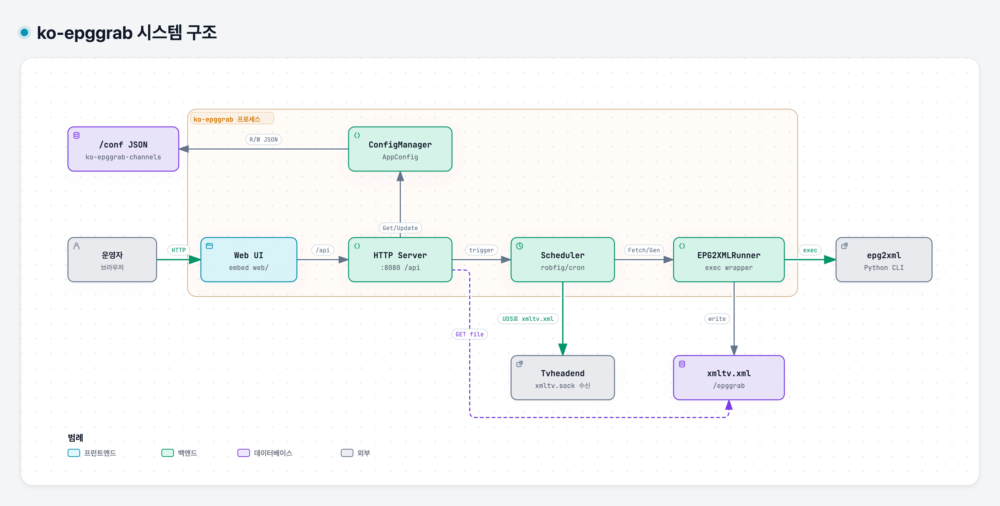
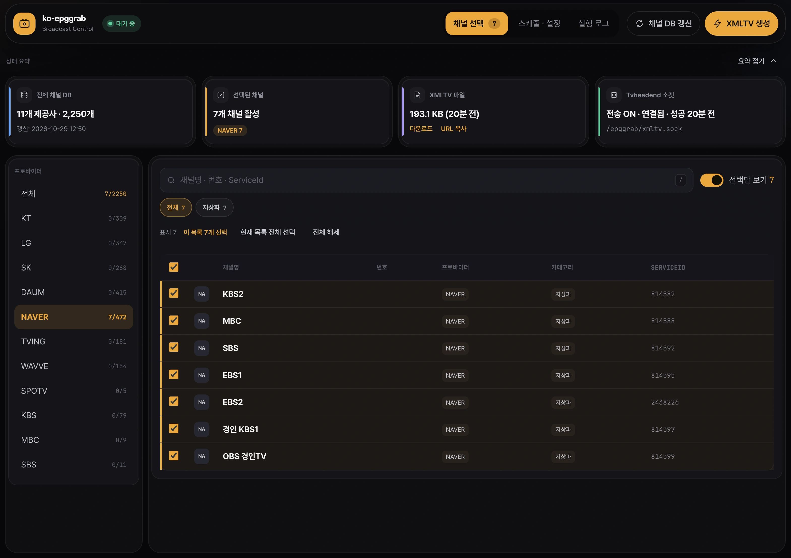
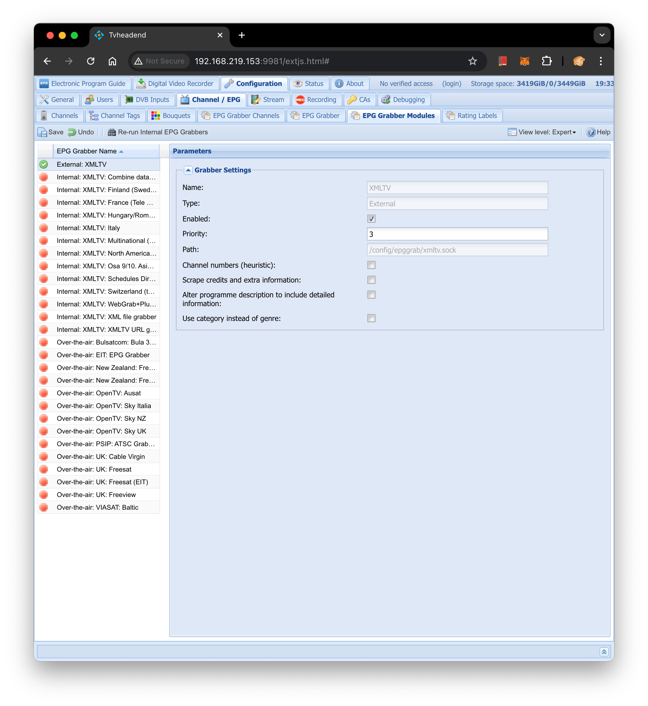
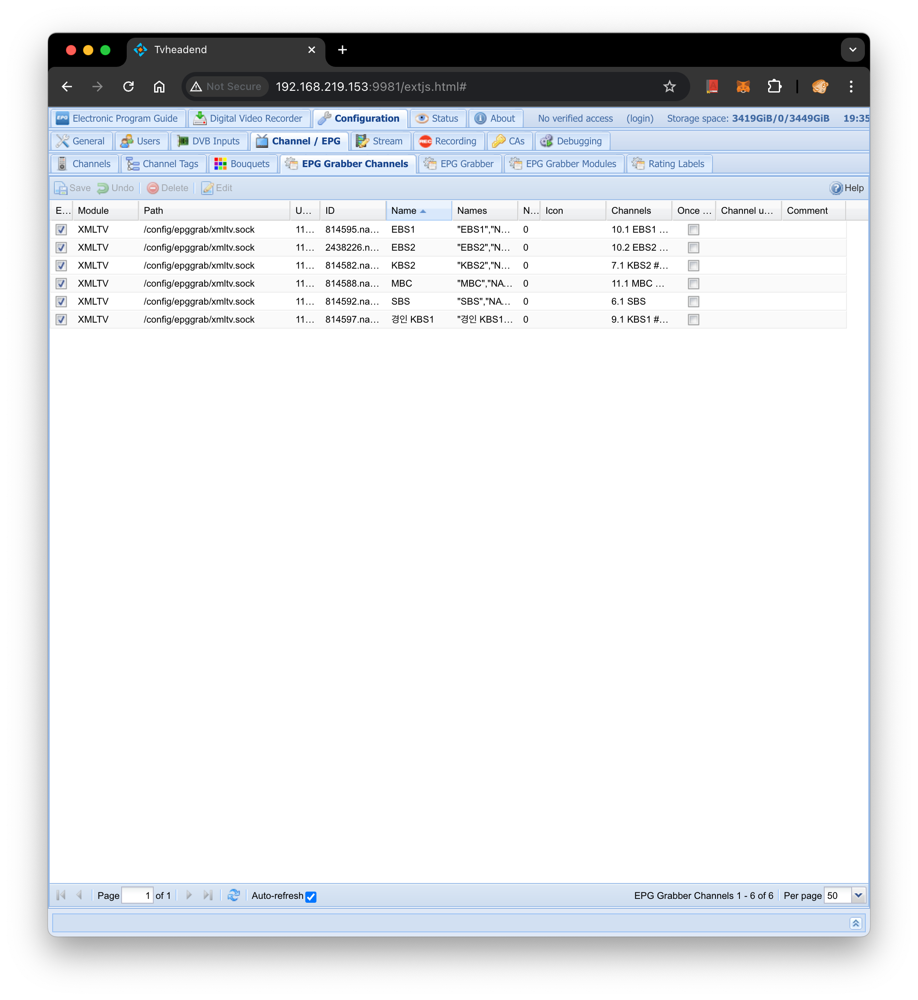

# ko-epggrab

[한국의 OTA EPG](https://namu.wiki/w/%EC%A0%84%EC%9E%90%20%ED%94%84%EB%A1%9C%EA%B7%B8%EB%9E%A8%20%EC%95%88%EB%82%B4#s-2)는 부실하게 관리되고 있다.
일 예로 Tvheadend에서 지상파 OTA EPG만 쓰려 하면, 느린 속도에 부족한 정보까지 겹쳐 울화통이 터진다.

다행히 웹에서는 포털이나 IPTV 사업자가 자체 EPG를 내놓고 있고,
[`epg2xml`](https://github.com/epg2xml/epg2xml)으로 Tvheadend XMLTV Grabber가 읽는 `xmltv.xml`을 만들 수 있다.
문제는 채널 고르기, 주기 실행, 소켓 전송을 매번 손으로 맞추는 일이다.

`ko-epggrab`은 `epg2xml`을 감싼 Go 데몬이다.
내장 웹 UI에서 채널과 스케줄, 옵션을 바꾼 뒤 Cron으로 돌리고,
나온 `xmltv.xml`을 Tvheadend Unix Domain Socket으로 넘긴다.





## 기능

- 웹 UI에서 프로바이더, 카테고리, 검색으로 채널 선택
- Cron 주기와 소켓 전송, `epg2xml` GLOBAL 옵션을 런타임에 변경
- 수동 채널 DB 갱신 / XMLTV 생성, 실행 로그 확인
- `GET /xmltv.xml` HTTP 서빙

## 빠른 시작 (Docker)

[`docker-compose.yml`](docker-compose.yml)을 받아 Tvheadend와 함께 올린다.
핵심은 `epggrab_data` volume을 공유하는 것이다. Tvheadend는 `/config/epggrab`, ko-epggrab은 `/epggrab`에 마운트해 `xmltv.sock`을 같이 쓴다.

```sh
curl -fsSL -O https://raw.githubusercontent.com/suapapa/ko-epggrab/main/docker-compose.yml
docker compose up -d
```

1. 컨테이너 기동 후 `http://<host>:8080` 접속
2. 채널DB 갱신으로 전체 채널 목록 수집
3. 원하는 채널을 선택하고 저장
4. XMLTV 생성 실행 (또는 Cron 대기)

## 환경 변수 (부트스트랩)

| 변수 | 기본값 (Docker) | 설명 |
| --- | --- | --- |
| `HTTP_ADDR` | `:8080` | 웹 UI / API 리스닝 주소 |
| `KO_EPGGRAB_CONF` | `/conf/ko-epggrab.json` | 런타임 설정 (Single Source of Truth) |
| `EPG2XML_CHANNEL_CONF` | `/conf/epg2xml_channels.json` | 전체 채널 DB |
| `EPG2XML_PROGRAM_CONF` | `/conf/epg2xml.json` | `epg2xml` 실행용 설정 (자동 생성) |
| `XMLTV_XML_PATH` | `/epggrab/xmltv.xml` | 생성 XMLTV 경로 |
| `XMLTV_SOCK_PATH` | `/epggrab/xmltv.sock` | Tvheadend UDS 경로 |
| `CRON_CHANNEL_FETCH` | `0 0 * * 1` | 최초 설정 파일 seed |
| `CRON_GENERATE_XMLTV` | `0 */12 * * *` | 최초 설정 파일 seed |

스케줄과 채널 선택, 옵션은 웹 UI에서 바꾸고 `ko-epggrab.json`에 저장한다.

## 로컬 개발

```sh
python3 -m venv .venv
source .venv/bin/activate
pip install git+https://github.com/epg2xml/epg2xml.git

go build -o ko-epggrab
./ko-epggrab
# → http://localhost:8080
```

## Tvheadend 설정




## 참고

- 상세 설계: [`DESIGN.md`](DESIGN.md), [`DESIGN_UI.md`](DESIGN_UI.md)
- 기반 도구: [`epg2xml`](https://github.com/epg2xml/epg2xml)

## License

[MIT](LICENSE)
